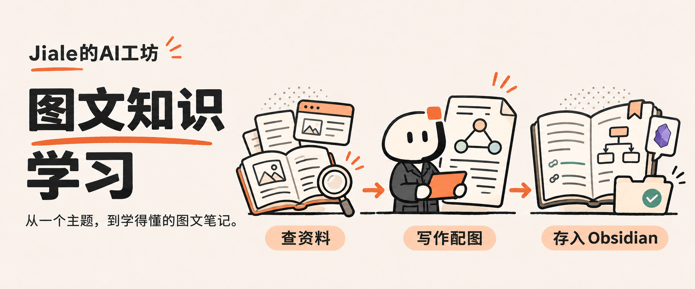
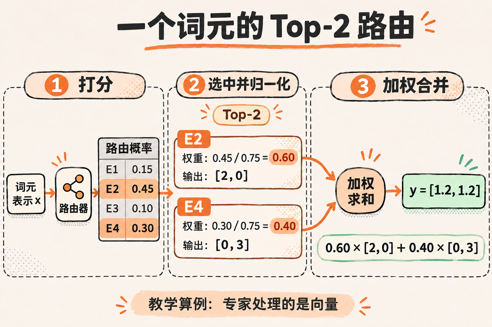

# 图文知识学习 · Illustrated Knowledge

**给一个主题，查清资料，讲透原理，留下图文笔记。**



[能做什么](#它能帮你做什么) · [看产出](#一次学习会留下什么) · [安装使用](#快速开始) · [制作项目介绍](#也可以用它写项目-readme) · [常见问题](#常见问题)

「Jiale 的 AI 工坊」的一套图文学习技能。让 Agent 把检索、解释、配图和整理连成一条流程：你提出主题，它沿着问题把原理讲清，再把文章、图片和来源一起保存下来。也可以用同样的方法，为 GitHub 项目制作读得懂、跟得上的图文 README。

## 它能帮你做什么

适合需要调研新知识、理解技术原理，又希望把所学长期留下来的人。

| 你手里的问题 | 它怎样展开 | 最后得到什么 |
| --- | --- | --- |
| “我想学懂 MoE / KV Cache / RAG” | 查一手资料，交代背景，再沿具体例子解释机制 | 有来源、有例子、有配图的知识文章 |
| “原理看懂了，工程上怎么判断？” | 比较资源、成本与成立条件，把模型和系统执行连起来 | 对比表、流程图与结尾综合总结图 |
| “这篇笔记还缺背景或总结” | 沿现有文章修改指定部分，复用已有图片 | 连贯的图文笔记，保留已有成果 |
| “帮我把这个项目介绍清楚” | 读实际仓库，讲用途、产出、安装与第一次使用 | 品牌封面、实际示例和图文 README |

## 一次学习会留下什么

以 **MoE 的工作原理** 为例，完整文章从一句准确的定义开始，补充技术背景，再讲词元路由、专家训练、负载均衡、参数与资源、跨卡执行，最后用一张综合图收束。

> **MoE（混合专家）**是一种按输入调用并组合专家网络的模型架构；大语言模型常用稀疏路由，让每个词元只激活少数专家，以扩大参数容量并控制计算量。

正文保留推理过程，图片解释结构与变化。例如先选出 E2、E4，再用 0.60、0.40 合并两个专家的输出：



完整图文学习通常留下：

- **一篇知识文章**：通常 3000–6000 中文字，有背景、机制、具体例子与工程取舍。
- **3–5 张解释图**：原理、流程或对比图，包含一张更完整的结尾总结图。
- **可追溯的资料**：正文来源链接、资料底稿，以及每张图片的最终提示词。
- **可继续使用的笔记**：YAML 元信息、真实图片文件和已经核实的关联链接，保存到 Obsidian。

[继续看 MoE 示例与综合总结图](examples/moe.md)。篇幅和图量按主题调整；项目 README 按读者的安装与使用路线组织。

## 快速开始

### 1. 安装技能

在 Codex 中发送：

```text
用 $skill-installer 帮我安装这个仓库里的 illustrated-knowledge 技能：
https://github.com/Jiale077/illustrated-knowledge
```

Codex 可从仓库安装技能并自动发现；如果没有出现，重启 Codex。安装与本地技能目录见 [OpenAI 官方说明](https://learn.chatgpt.com/docs/build-skills)。

<details>
<summary>想手动安装？展开查看</summary>

以下适用于 macOS / Linux 终端，将仓库放入用户级技能目录：

```sh
mkdir -p "$HOME/.agents/skills"
git clone https://github.com/Jiale077/illustrated-knowledge.git \
  "$HOME/.agents/skills/illustrated-knowledge"
```

确保 `SKILL.md` 位于 `illustrated-knowledge` 目录根下。已有安装时沿用原目录更新，避免复制出第二份同名技能。其他 Agent 需要支持 `SKILL.md`、文件读写、联网检索和图片生成。

</details>

### 2. 告诉它笔记放在哪里

第一次使用时，直接说明：

```text
我的 Obsidian 笔记库在「填写实际路径」，
知识笔记放进「库内笔记目录」，图片放进「库内附件目录」。
请把这些位置写进这个技能的本地配置。
```

也可以将 [config.example.json](config.example.json) 复制为技能目录中的 `config.local.json`，填写：

```json
{
  "vault": "/path/to/ObsidianVault",
  "note_area": "Learning",
  "image_root": "Attachments/illustrated-knowledge"
}
```

`vault` 改成实际笔记库的绝对路径；另两项是库内相对目录。已有知识库分类时使用原有目录。本地配置已被 Git 忽略。**只制作项目 README 时，可以跳过笔记库配置。**

### 3. 给出第一个主题

```text
用 $illustrated-knowledge 学习 MoE 的工作原理。
从为什么需要它开始，用一个 Top-2 算例解释路由，
再讲总参数、激活参数和跨卡执行，配图后保存到 Obsidian。
```

Agent 会按需查证资料、撰写文章、生成配图，并返回实际保存位置。Obsidian 中的开篇定义使用浅橙底卡片，正文与图片保存在原笔记库中。

想换重点或只改局部，可以继续说：

```text
这篇文章多讲一点通信开销，沿现有文章补充。
```

```text
只修改开头定义卡片，正文和图片保持原样。
```

## 也可以用它写项目 README

**这份 README 就采用这套图文流程制作。** 先核对仓库能力和安装方式，用封面讲清使用路径，再用真实产出示例说明结果。

给它一个仓库链接或本地目录：

```text
用 $illustrated-knowledge 给这个项目制作图文 README：
〈仓库链接或本地目录〉。

先讲清它能做什么、产出是什么样，再教第一次安装和使用。
开头做一张 Jiale 的 AI 工坊风格封面，使用真实项目示例。
```

README 模式输出项目内的 Markdown、封面、必要示例和提示词。它会检查实际文件、配置与命令，使用 GitHub 能显示的图片链接和排版。没有要求入库时，直接保存在项目中；需要上传时沿用户授权发布。

具体规则见 [项目图文 README 工作流](references/readme.md)。

## 从主题到图文结果

1. **查资料**：优先官方文档、论文、源代码和原始发布，平台内容优先复用 Agent Reach。
2. **写清楚**：开头保留完整定义，再解释背景、动机、机制、算例和应用条件。
3. **画出来**：用原生 Image 生成解释图，核对中文字、数字、箭头与比较关系。
4. **串起来**：知识文章用综合总结图恢复全篇主线；项目介绍沿安装和使用路线展开。
5. **保存好**：笔记入库，图片、提示词和资料记录一起归档；README 则保存到项目。

默认采用 **Jiale 的 AI 工坊** 视觉：暖白纸底、墨线轮廓、橙色重点与少量青绿结果色。封面是品牌概念插图，MoE 配图是教学图解；具体条件和来源在相应正文、图注中交代。

## 运行环境与可选工具

| 能力 | 需要什么 |
| --- | --- |
| 阅读、查证与写作 | 能联网并读写文件的 Agent；本仓库以 Codex 使用方式示范 |
| 生成和修改配图 | 宿主的原生 Image / imagegen 能力 |
| 知识笔记归档 | Python 3.10+ 与可写入的 Obsidian 库；脚本只用标准库 |
| 平台搜索与读取 | 优先复用 [Agent Reach](https://github.com/Panniantong/Agent-Reach)，渠道以实际配置为准 |
| 辅助写作与配图规划 | 可选 [content-research-writer](https://github.com/ComposioHQ/awesome-claude-skills/tree/master/content-research-writer)、[baoyu-article-illustrator](https://github.com/JimLiu/baoyu-skills/tree/main/skills/baoyu-article-illustrator) |

已有工具直接复用，第三方技能不随本包分发。没有可用的图片生成能力时，保留草稿和配图计划，并说明尚缺的图片；不能把图片计划当作完成图文结果。

## 常见问题

**必须先装齐所有辅助技能吗？** 先具备联网、文件读写和图片能力即可。Agent Reach 优先用于平台资料，其他写作与配图技能是可选辅助。

**会覆盖已有笔记吗？** 归档脚本新增笔记，同名时追加版本后缀。修改已有文章时先备份，按指定范围更新；只改卡片时保留原图。

**只能存进 Obsidian 吗？** 知识文章默认入库；项目 README 直接保存在项目中，也可以按要求额外导出或入库。

**更新时会丢配置吗？** 个人路径放在被忽略的 `config.local.json`。更新技能时保留该文件；已经定制的 CSS 先读取后处理。

**GitHub 为什么没显示定义卡片？** 彩色卡片由 Obsidian CSS 呈现。GitHub 使用普通引用显示相同定义，正文信息保持完整。

## 文件与验证

| 文件 | 用途 |
| --- | --- |
| [SKILL.md](SKILL.md) | 入口、输出形式和执行流程 |
| [写作规则](references/writing.md) | 完整定义、解释密度和总结图 |
| [视觉规范](references/jiale-style.md) | 工坊配图与封面参考 |
| [README 工作流](references/readme.md) | 项目用途、产出、安装与使用的图文组织 |
| [归档规则](references/obsidian.md) | 配置、图片清单与 Obsidian 入库 |
| [归档工具](scripts/archive_note.py) | 复制文章、真实图片、提示词与记录 |
| [封面提示词](docs/cover-prompt.md) · [本文资料依据](docs/readme-sources.md) | 本页的视觉制作与查证记录 |

开发者可在仓库根目录运行：

```sh
python3 -m unittest discover -s tests -v
python3 scripts/archive_note.py --help
```

归档先使用 `--dry-run` 检查计划，再保存。工具检查文件、标记和路径；事实查证与图片可读性由 Agent 另行核对。
