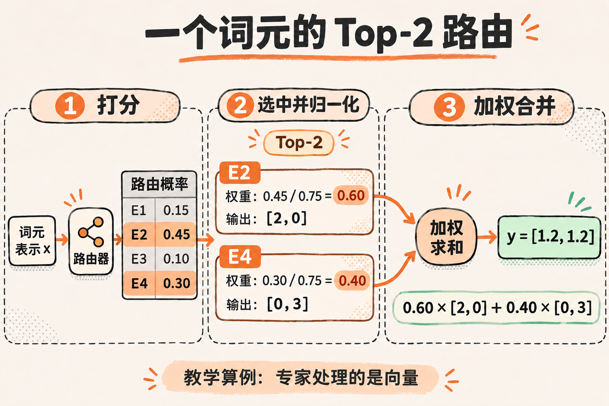
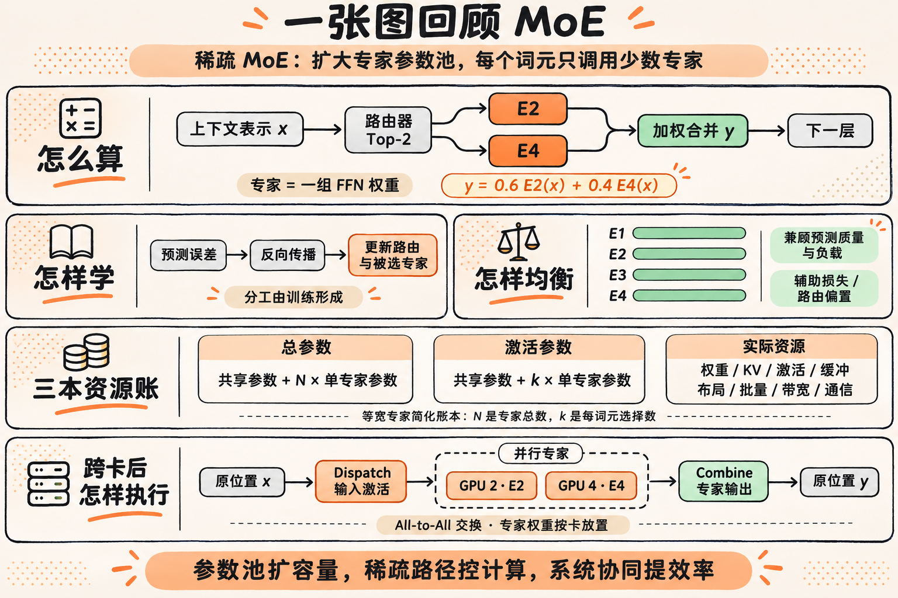

# 示例：MoE 的工作原理

这是一次完整图文学习产出的节选，用于展示定义、机制例子和结尾综合图的组织方式。图片采用原版 Jiale 的 AI 工坊风格。

> [!jiale-definition]
> **MoE（混合专家）**是一种按输入调用并组合专家网络的模型架构；大语言模型常用稀疏路由，让每个词元只激活少数专家，以扩大参数容量并控制计算量。

上面的 callout 在 Obsidian 中使用本包 CSS 显示为定义卡片；GitHub 上按普通引用显示。

## 跟着一个词元算一次 Top-2

假设路由器对四个专家给出概率 E1=0.15、E2=0.45、E3=0.10、E4=0.30。本例选择概率最高的 E2、E4，并将这两个概率重新归一化，得到权重 0.60、0.40。

若专家输出分别为 [2, 0]、[0, 3]，合并结果为：

```text
0.60 × [2, 0] + 0.40 × [0, 3] = [1.2, 1.2]
```

这些数值是教学算例，用于展示选取与加权过程。路由与组合方式参考 [Mixtral 论文](https://arxiv.org/html/2401.04088v1) 的第 2.1 节。



## 结尾综合图

完整文章在讲清路由、训练、负载均衡、参数账本与专家并行之后，用一张图重新连起模型机制和系统执行。



原理与工程实现可继续阅读 [Switch Transformers](https://www.jmlr.org/papers/volume23/21-0998/21-0998.pdf)、[DeepSeek-V3 技术报告](https://arxiv.org/html/2412.19437v2) 与 [DeepEP](https://github.com/deepseek-ai/DeepEP)。本页为展示节选，不替代完整文章的资料底稿。
